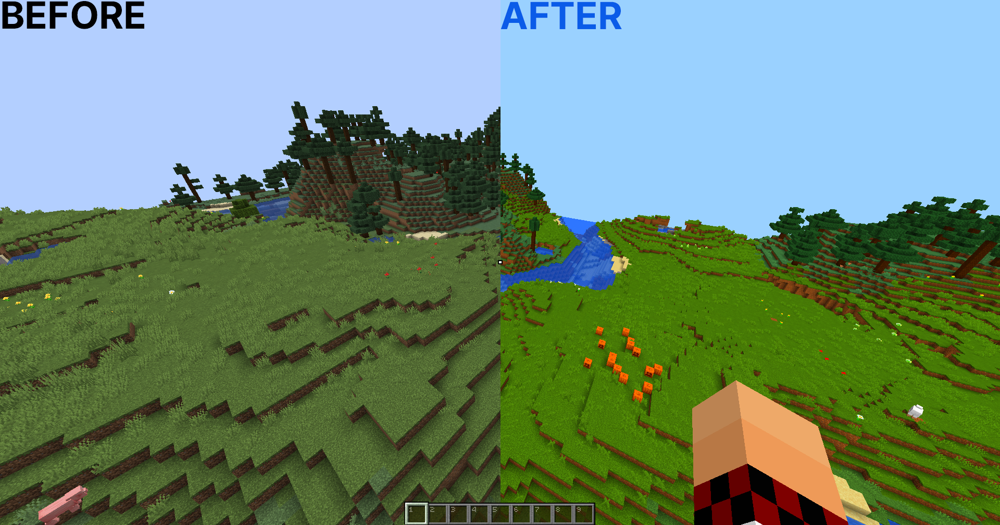

# ColorSaturation

ColorSaturation is a shader that recolors your world. Crank the saturation up for punchier colors, or pull it all the way down to play in grayscale. There are sliders for contrast, brightness and hue too.

## Supported versions

- Minecraft 1.8.9 on Ornithe.
- Minecraft 1.21.1-26.3 on Fabric.

ColorSaturation needs [OneConfig](https://modrinth.com/mod/oneconfig) and Fabric Language Kotlin.

## Support

- Report bugs and ask questions on the [Polyfrost Discord](https://polyfrost.org/discord).
- Check [Polyfrost Status](https://status.polyfrost.org/) if a Polyfrost service is down.
